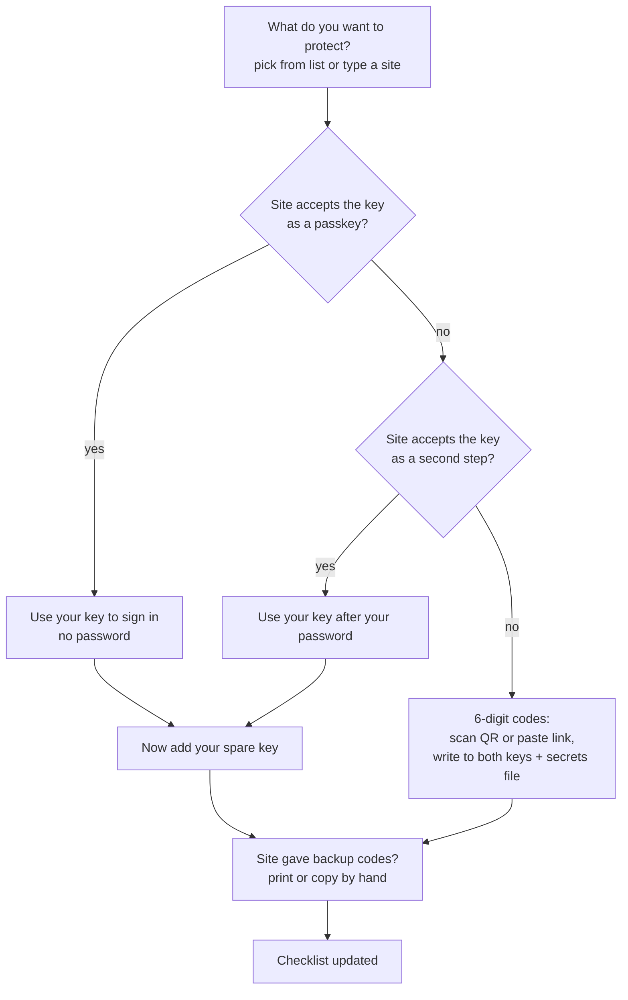

# Kenaz

A simple desktop app that helps everyday people — the ones still using the same password everywhere — protect their accounts with a YubiKey, and keep a spare so losing it isn't a disaster. Once the accounts are safe, the same key can also sign and encrypt email and files, sign in to a computer, and unlock a password manager.

## Problem

Current tools assume you already know what you're doing:

- **Kleopatra** is powerful, but you need to understand public vs. secret keys, certificates, smartcards, and trust before you can do anything useful.
- **Yubico Authenticator** uses friendly labels (Accounts, Passkeys, Fingerprints, Certificates, Slots), but each section is a separate feature. Nothing tells you where to start, which accounts to protect first, or how to avoid getting locked out if you lose the key.

Neither tool helps someone go from "I reuse one password" to "my important accounts are protected and I have a backup".

## Who it's for

- People who reuse passwords and have never set up two-step login.
- People who were handed a YubiKey and don't know what to do with it.
- People whose accounts are already protected and want the next step: signing or encrypting email and files, signing in to a computer or server with the key, or unlocking a password manager with it.
- Not for: security engineers, organisations rolling out keys and certificates to staff, or anyone who needs custom OpenPGP key layouts. Yubico Authenticator, Kleopatra and `ykman` already cover them.

## Positioning

Not a replacement for Yubico Authenticator. It's a **guided companion** for the first and most common job: securing everyday accounts. Email/file encryption (OpenPGP), certificates and computer sign-in (PIV) and button features (OTP slots) come after that job, as tasks on the same home screen, never as the starting point. Anyone who outgrows it can switch to the official tools with the same key.

## Scope

- **YubiKey only**, on desktop: Linux and Windows (x86-64 and ARM64) for 1.0. Linux means Wayland sessions only (no X11); only the latest release of each OS is tested, plus Ubuntu LTS. macOS needs an external contributor (see Roadmap). Android and iOS are on the roadmap, not in the initial release. Only the YubiKey 5 and the Security Key are tested on hardware; the YubiKey 4 and YubiKey 5 firmware before 5.7 are handled by capability detection but untested ([decision](docs/decisions/2026-11-09-release-platforms-and-test-hardware.md)).
- **Passkeys and security keys (FIDO2/U2F):** explain what they are, guide the user through adding the key on popular sites, either as a passkey (sign in with the key, no password) or as a security key (the key as a second step after the password). Manage the key's PIN, and list or remove passkeys stored on the key.
- **6-digit codes (OATH TOTP):** add accounts by scanning a QR code on screen or pasting a setup link; show codes; copy them with one click.
- **Encrypt and sign (OpenPGP):** create one key pair for the person, put it on both YubiKeys, export the public key, and guide the user through using it in common apps (Thunderbird, Kleopatra, GnuPG). Manage the PIN, admin PIN and reset code, and the "touch to use" setting. The app does not send or read email itself.
- **Certificates and smart card (PIV):** create one key pair and a certificate for each use (sign in, sign documents), put them on both YubiKeys, and export the certificate. Guide the user through common uses such as signing in to their computer, SSH, and signing PDFs. Import a certificate someone else issued. Manage the PIN and PUK; the management key stays out of sight in the app and is only printed on the recovery sheet (see PINs).
- **Mexico's e.firma (SAT FIEL):** import the user's `.cer`, `.key` and password, check the key matches the certificate, and put both on the signature slot (9c) of both YubiKeys, in place of the app-made signing certificate. The key goes into the secrets file like any other PIV key. Then set up PDF signing in the user's existing apps (Okular first) and show the steps. The app never signs PDFs itself and never asks the user to delete the original files: SAT needs them to renew the e.firma.
- **Button features (OTP slots):** explain why the key types random letters when touched (factory Yubico OTP in the short-press slot) and offer to move it to long press or remove it. Set up challenge-response for password managers and computer login (for example KeePassXC), on both keys.
- **Encrypted secrets file (age):** every secret the app needs to set up a spare or replacement key later (6-digit code setup secrets, challenge-response secrets, the OpenPGP and PIV keys, the OpenPGP admin PIN and reset code, the PIV PUK) is kept in one file encrypted with [age](https://age-encryption.org/v1) to the YubiKeys. Nothing secret is ever written to disk unencrypted.
- **Backup key:** setup asks for two keys from the start and treats the second key as part of setup, not an extra. The spare is optional, but skipping it brings a clear, repeated warning (see User workflows).

## Principles

1. **Tasks, not features.** The home screen asks "What do you want to protect?", not "Choose an application".
2. **Plain language first.** No jargon on the main path. An "advanced details" view shows the real terms for the curious.
3. **The backup is part of setup.** Every flow that puts something on one key (an account, an OpenPGP or PIV key, a button secret) also puts it on the spare. If the user skips the spare, they get a clear, repeated warning.
4. **Never lock someone out silently.** Warn before PIN retry limits run out, before a reset, and before deleting anything. Explain the consequences in plain words.
5. **Start with what matters most.** Suggest protecting email first (it's the key to resetting every other account), then banking, then social media. The order is advice: the user always picks the site (see Key storage limits → Which sites first).

## Backup: hard limits vs. product policy

Secrets can't be copied off a YubiKey. What that means depends on the feature:

- **Passkeys and security keys:** each website registers each key separately. You can add a spare key to a site later, as long as you can still sign in (with the first key or another method). Yubico recommends registering the spare straight away, but doesn't require it ([source](https://www.yubico.com/products/spare/)). The app can't register keys on websites itself; it can only guide the user and keep a checklist of which sites have both keys. Security keys used as a second step aren't stored on the YubiKey at all; the site keeps them.
- **6-digit codes:** the spare needs the same setup secret (the QR code or setup link) as the first key, and that secret can't be read back off the first key. To add the spare later, the user needs a saved copy of the secret, or has to turn two-step login off and on again on that site, which makes the first key's codes stop working.
- **OpenPGP and PIV:** a key pair generated on a YubiKey can never leave it, so two keys that each generate their own pair end up as two different identities: other people (or servers) would need both public keys, a certificate issued for one key doesn't work on the other, and losing one key means losing what was encrypted only to it. Having the same key pair on both YubiKeys means generating it outside the keys and writing it to each. Certificates are public and can be copied freely.
- **OTP challenge-response:** same as 6-digit codes. The secret can't be read back, so both keys need it written at setup, or the password manager has to be re-enrolled later.

**Product policy:** set up both keys together for every feature. That's the only clean option for codes, OpenPGP, PIV and challenge-response, and it stops passkey spares from being forgotten. The app should:

- 6-digit codes, OpenPGP, PIV and challenge-response: write the secret to the first key, save it to the encrypted secrets file (below) as soon as that write succeeds, then write it to the second key, in one step if both are plugged in, otherwise by prompting for the second key while the secret is still in memory. Then wipe it from memory. Once the save has committed, a spare that wasn't written is finished later from the file (workflow 4); if the app closes before the save commits, the spare can't be finished from the file and needs a new setup. Never write it to disk unencrypted ([decision](docs/decisions/2026-11-09-secret-save-order.md)).
- OpenPGP and PIV: generate key pairs in the app's memory (not on the YubiKey), so both YubiKeys hold the same identity. This trades "the key never existed outside the hardware" for "losing one YubiKey loses nothing", which is the right trade for most people.
- **Recovery sheet, one per key** (template: `templates/recovery-sheet/`): a printable sheet with everything needed to recover or replace that key, for the case where the YubiKeys are lost and the secrets file can't be opened. It prints the machine-made secrets that can't set a new PIN (PIV management key, 6-digit code secrets with their QR codes, challenge-response secrets) and the identities on the key (certificates, OpenPGP fingerprints, passkey sites, secrets file recipients). The PIN, the PUK, the OpenPGP admin PIN and the OpenPGP reset code are never printed: the sheet has empty boxes and the user writes them by hand. Private keys are not printed; they live in the secrets file, and the e.firma also in SAT's original files. The e.firma password isn't on the sheet. The sheet says plainly that anyone holding it and the key can sign in and sign as the user, and to store it like a passport. A new sheet is due whenever one of its secrets changes, and the old one should be destroyed.
- Passkeys and security keys: prompt "now add your spare key" right after each site is registered, and keep any site with only one key on the checklist as "spare missing" so the user can finish it later.

## Encrypted secrets file (age)

One file, in the standard [age](https://age-encryption.org/v1) format, holds the secrets listed in Scope. It lets the user replace a lost key: plug in the surviving key, unlock the file, and the app writes the 6-digit code accounts, the OpenPGP and PIV keys and the challenge-response secrets onto the new key.

**Passkeys and security keys can't be restored this way.** They aren't in the file and can't be copied (see Backup), so the user has to register the replacement key separately on every website, signing in with the surviving key. The app adds every such site to the checklist as "missing on this key" until that's done, and says this plainly before the replacement starts.

### What opens the file: the user chooses

The first time the app needs to store a secret (the first 6-digit code account, OpenPGP or PIV key, or challenge-response secret), the user picks one or more ways to unlock the file. Setting up the chosen method happens then, not at first-time setup. age encrypts to every chosen method, and any one of them opens it. Each option is explained in plain words; which one to recommend is still open.

| Option | Opens with | Works on | Open outside the app with | Trade-offs |
|---|---|---|---|---|
| **OpenPGP** (Curve25519 decryption key) | the OpenPGP key that's already on both YubiKeys | YubiKey 5, firmware 5.2.3+ ([Yubico](https://www.yubico.com/blog/whats-new-in-yubikey-firmware-5-2-3/)) | `age`/`rage` + [`age-plugin-openpgp-card`](https://github.com/wiktor-k/age-plugin-openpgp-card); the recipient is a plain `age1…` key, so encrypting needs no plugin | Requires setting up OpenPGP, even for people who never sign an email. Small, little-known plugin. |
| **PIV** (P-256 key in a retired slot) | a PIV key on both YubiKeys | YubiKey 4 and 5 | `age`/`rage` + [`age-plugin-yubikey`](https://github.com/str4d/age-plugin-yubikey) | The most widely used and packaged YubiKey age plugin. Takes one PIV slot. |
| **FIDO2** (`hmac-secret`) | the passkey part of each YubiKey; one recipient per key | Any FIDO2 key, including the Security Key series | `age`/`rage` + [`age-plugin-fido2-hmac`](https://github.com/olastor/age-plugin-fido2-hmac) | No extra applet, uses the passkey PIN. On Windows, opening the file triggers the admin (UAC) prompt (see Platform & tech). A replacement key needs a new recipient, so the file is re-encrypted. |

Whatever the user picks gets a plain name ("your secrets key"); "OpenPGP", "PIV" and "FIDO2" only appear in the advanced details view. If none of the options works on the user's keys, the app falls back to the in-memory flow and the printable sheet, and says so.

### PINs

- **One PIN for the person:** the passkey PIN, the OpenPGP user PIN and the PIV PIN are set to the same value. It must be 6 to 8 **ASCII** characters (letters without accents, digits, common symbols): PIV stores the PIN as 6 to 8 bytes and the YubiKey allows any ASCII character there ([Yubico](https://docs.yubico.com/yesdk/users-manual/application-piv/pin-puk-mgmt-key.html)), while an accented letter takes 2 bytes and isn't ASCII. 6 is also the OpenPGP minimum. Because a Spanish keyboard makes "ñ" or "á" easy to type, the PIN screen checks this as the user types and explains the rule in plain words ("letters without accents, numbers and symbols"), instead of failing later when the PIN is written to the key.
- **Admin codes are different and random:** the OpenPGP admin PIN, the OpenPGP reset code and the PIV PUK are never the same as the PIN. The app generates them as 8 printable ASCII characters (PUKs with bytes above `0x7F` are rejected from firmware 5.7; 8 is the OpenPGP admin PIN minimum and the PIV PUK maximum, and fits the 8 boxes on the recovery sheet) and stores them in the secrets file; the user never has to remember them. Each one can set a new PIN, so none of them is ever sent to a printer: the app shows them once on screen for the user to copy by hand onto the recovery sheet. If one key's PIN gets blocked, the spare opens the file and the app unblocks the first key with the stored reset code or PUK.
- **PIV management key:** random, and stored on the key protected by the PIN, which is how `ykman` and Yubico Authenticator handle it (`yubikit`'s `piv_util` covers this). Other tools keep working with the key. It is also printed on the recovery sheet, so the key can still be managed with other tools if the app is gone.

### Other rules

- **Where it lives:** the app's data folder, plus a prompt to keep a copy somewhere else (cloud drive, USB stick). The copy is safe to store anywhere, because it is useless without one of the YubiKeys and its PIN.
- **Not a vault:** it only holds secrets the app created or received during setup. It is not a general place for passwords or files (see Out of scope; encrypting the user's own files is on the roadmap).
- **Check before any reset.** A reset destroys that key's way of opening the file: a passkey reset kills its FIDO2 unlock credential (the reset invalidates every credential on the key, see workflow 7), and a full reset also wipes its OpenPGP and PIV keys. Before any reset, the app works out which unlock methods survive it and **actually opens the file with one of them** (the spare, or an OpenPGP/PIV unlock on the same key when only the passkey part is reset). Only then does it continue, and afterwards it re-encrypts the file to drop the dead method and add the reset key back once it's set up again. If no surviving method opens the file, the app stops and says plainly: "after this reset, nobody can ever open your secrets file again, and the spare can't be rebuilt from it." It offers the ways out first (plug in the spare, or add another unlock method while this key still works) and allows the reset only after an explicit confirmation.

## Sign-in checklist

The app reads the passkeys stored on both keys and builds the checklist from them, marking each site as "both keys", "spare missing" or "missing on this key". Security keys used as a second step, and sites that don't store a passkey on the key, can't be detected; the user adds them by hand and ticks them off. The step text asks the user to name each key on the site ("YubiKey main", "YubiKey spare"), so a lost key is easy to find and remove later.

## Key storage limits

Passkeys and 6-digit code accounts live on the key itself, in limited space. Firmware can't be updated, so a key keeps the limits it was sold with. The app reads the firmware version and the space left from each key.

| On the key | Firmware before 5.7 | 5.7 and 5.8 |
|---|---|---|
| Passkeys | 25 | 100 |
| 6-digit code accounts | 32 | 64 |

The Security Key series holds passkeys only, with the same 25/100 split. PIV, OpenPGP and button slots are fixed per feature and the app uses only a few of them, so they don't run out. Sources: [5.7 firmware](https://docs.yubico.com/hardware/yubikey/yk-tech-manual/yk5-firmware-5.7.html); [5.8 firmware](https://docs.yubico.com/hardware/yubikey/yk-tech-manual/yk5-firmware-5.8.html), which "supports all of the capabilities of YubiKey 5.7.4", reports "no material changes" to PIV and OTP, and lists no storage change.

- **What takes a passkey space:** only a discoverable credential, which the site asks for when the key is registered (WebAuthn `residentKey`). A site's "key after your password" setup usually doesn't ask for one and then uses no space, but some sites do. The app can't tell beforehand and can't change what the site asks for. Afterwards it can: credential management (firmware 5.2.3+) lists the passkeys on the key and how many spaces are left; sites that took no space don't appear ([Yubico](https://developers.yubico.com/WebAuthn/WebAuthn_Developer_Guide/Resident_Keys.html)).
- **A pair is limited by its smaller key**, because every passkey site and code account goes on both. A YubiKey 5 on 5.7 paired with an older key holds 25 passkeys and 32 code accounts, not 100 and 64.
- **Code space and the spare:** a full first key stops the write: nothing is written or saved. A full spare doesn't: the account is written to the first key and saved to the secrets file as usual ([decision](docs/decisions/2026-11-09-secret-save-order.md)), and the spare gets a "spare missing: no room" item that workflow 4 finishes once the user makes room. If the spare is full (by its last-known space when it isn't plugged in, see Telling the user), the app says so before writing, so the user can make room first or go on. If the spare was skipped, there's nothing to check. The one exception is the in-memory fallback (no secrets file): the spare must be written before the app closes, so both keys need room before anything is written.
- **Firmware 5.8** adds no storage, but adds things the app uses when the key reports them:
  - FIDO over the smart-card interface (CCID) on USB, which may let the passkey screens skip the Windows admin prompt (see Platform & tech).
  - `maxPINLength` and `pinComplexityPolicy` in the key's info, so the PIN screen checks the key's own rules before writing.
  - `longTouchForReset` and `transportsForReset`, so the reset steps can say "hold your finger on the key for 5 seconds" or "plug it in; a tap on the phone won't work" when the key requires it.
  - A persistent read-only token for the passkey list (PPUAT with the PCMR permission), so the checklist refreshes without asking for the PIN each time. Whether `yubikit` exposes it is still to check.
  - FIPS keys stay on 5.7.4.

### Telling the user

- **Smallest key counts:** the total the user is told is the lowest capacity among the user's keys (25 if any key is before 5.7). Every "spaces left" count and warning uses the lowest free space among them, plugged in or not; this can be a different key from the one with the lowest capacity. For a key that isn't plugged in, the app uses the counts it read the last time that key was plugged in, and says how old they are.
- **Always (required):** the first time the user adds a passkey, the app says plainly how many the keys can hold ("Your keys can hold up to 25 sign-ins like this. Many sites don't use this space."), using the lowest capacity. "Am I protected?" always shows the spaces used on each key.
- **Only one key:** nothing beyond that.
- **Two keys, either one before 5.7:** once a key before 5.7 holds 20 passkeys (counted on that key itself), before each new site the app says how many spaces are left, lists the sites using them, repeats the suggested order (below) and lets the user choose: use a space, or use the site's "key after your password" option if it has one. The app never removes a passkey on its own.
- **Two keys, both 5.7 or later:** nothing beyond the disclosure.
- **Key full:** the site's registration fails in the browser. The app explains why and opens the passkey list, where the user can remove a site they care about less, after a warning that they need another way to sign in to it.

### Which sites first

The app suggests an order; the user decides, and can pick any site from the list or type one (workflow 2).

1. **Email:** Gmail (Google account), Outlook and Hotmail (Microsoft account), Proton Mail, Tuta. Email resets every other password. A Google or Microsoft account also signs in to other services (YouTube, Android, OneDrive, Xbox), so one space protects more.
2. **Banking,** where the bank accepts the key.
3. **Social media and messaging:** Facebook, Instagram and WhatsApp (Meta).
4. Everything else.

Which method each site supports (passkey, key after password, codes) lives in the curated site list, not here.

## User workflows

Kept as common and simple as possible. Workflows 1–7 are the product; 8–12 appear on the home screen once the first account is protected.

| # | Workflow | How often |
|---|---|---|
| 1 | First-time setup | once |
| 2 | Protect an account | a few times in the first week, then rarely |
| 3 | Get a 6-digit code | daily |
| 4 | Finish the spare | occasional |
| 5 | "Am I protected?" | occasional |
| 6 | Replace a lost or broken key | rare, high stakes |
| 7 | Forgot PIN / PIN blocked | rare, high stakes |
| 8 | "My key types random letters" | rare, very common confusion |
| 9 | Unlock a password manager | once per setup |
| 10 | Sign in to my computer | once per setup |
| 11 | Encrypt and sign email | once per setup |
| 12 | Give away or reset a key | rare |
| 13 | Sign PDFs with my e.firma (Mexico) | once per e.firma issue or renewal |

### Decisions

- **Spare at first-time setup:** optional, with a clear warning repeated on the home screen and after every account added to one key only.
- **Method per site:** passkey first, then security key, then 6-digit codes. One fixed order, no choice for the user, except on a pair with a key before 5.7 that already holds 20 passkeys, where the user chooses (see Key storage limits). If the site also hands out its own backup codes, the app strongly advises "print them or copy them by hand" and keep them with the recovery sheet. The app never stores or displays them.
- **Secrets file, OpenPGP and PIV:** set up when first needed, never at first-time setup.
- **Site list:** our own curated list of popular sites per language (Spanish and English). A community directory for search is on the roadmap.
- **Daily codes:** in the main window. No tray or quick panel in the first release.

### 1. First-time setup

1. Plug in key 1. The app checks it's a YubiKey and what it supports.
2. Choose one PIN (6–8 ASCII characters, see PINs).
3. Plug in key 2; the same PIN is applied. One USB port: "unplug this key and plug in the spare" screen. Skipping is allowed, with the spare warning.
4. Straight to "What do you want to protect?", with email suggested first.

### 2. Protect an account

- The app opens the site's security settings page and shows 3–5 illustrated steps from the curated list. Sites not on the list get generic steps.
- Passkey and security key are one user-facing path, "use your key"; the app says which variant the site uses.
- The first 6-digit code account also asks how to unlock the secrets file (once), before anything is written to a key, then offers the printable recovery sheet.

### 3. Get a 6-digit code

The main window lists the codes from whichever key is plugged in. One click copies a code; codes that need a touch say "touch your key". Works the same with either key.

### 4. Finish the spare

The home screen shows "spare missing" items. For each one: 6-digit codes, OpenPGP, PIV and challenge-response are copied from the secrets file automatically; passkey and security key sites get the same guided steps as workflow 2.

### 5. "Am I protected?"

One status view: how many sites are on both keys, which are missing the spare, passkey spaces used on each key, whether the secrets file has a copy outside the app's folder, and PIN tries left on each key.

### 6. Replace a lost or broken key

1. First step, always: "remove the lost key from your email account", then the other sites on the checklist.
2. Plug in the remaining key and the new one; set the same PIN on the new key.
3. Unlock the secrets file; codes, OpenPGP and PIV keys and challenge-response secrets are written to the new key.
4. Every passkey and security key site goes on the checklist as "missing on new key", with the workflow 2 steps. The app warns that some sites delay a new key: Google can take up to 7 days before a newly added security key works at sign-in ([Google](https://support.google.com/accounts/answer/6103523)).

### 7. Forgot PIN / PIN blocked

- The app warns while tries remain, in plain words, before every PIN entry with fewer than all tries left.
- OpenPGP and PIV blocked: plug in the other key, open the secrets file, unblock with the stored reset code or PUK, set a new PIN.
- Passkey PIN blocked: the only way out is a reset of the passkey part of the key. That erases every passkey on it and also stops it working as a security key on every site, because a reset invalidates all credentials, including those created as a second step ([CTAP 2.1 §6.6](https://fidoalliance.org/specs/fido-v2.1-ps-20210615/fido-client-to-authenticator-protocol-v2.1-ps-errata-20220621.html)). It also kills this key's FIDO2 unlock for the secrets file, so the reset only starts after the secrets file check (see Encrypted secrets file → Other rules). The app explains all of this before the reset and then puts every affected site on the checklist as "missing on this key".

### 8. "My key types random letters"

Explain what happened (the touch triggers the factory one-time password) and offer two fixes: move it to a long press (recommended), or remove it, with a warning that it can't be put back as it was.

### 9. Unlock a password manager

Pick the password manager from a short list (KeePassXC first) → the app writes a challenge-response secret to both keys and the secrets file → steps for enabling the key in that app.

### 10. Sign in to my computer

PIV key and certificate created in memory, written to both keys and the secrets file → guided pairing for the user's OS (Linux first, then Windows) → SSH and PDF signing offered as "more uses".

### 11. Encrypt and sign email

Name and email → OpenPGP key pair created in memory, written to both keys and the secrets file → public key exported → steps for the user's mail app (Thunderbird first).

### 12. Give away or reset a key

Shows what will be lost (sites, codes, keys), asks the user to remove the key from every site on the checklist first, runs the secrets file check (see Encrypted secrets file → Other rules), then resets with a final, plain confirmation.

### 13. Sign PDFs with my e.firma

Pick the `.cer` and `.key` files and type the e.firma password → the app checks they belong together and shows the name, RFC and expiry date from the certificate → key and certificate written to slot 9c on both keys and to the secrets file, each key checked with a test signature → PDF signing set up in the user's app (Okular first), with the steps. The status view ("Am I protected?") shows the e.firma expiry date. A renewed e.firma has a new key, so the user runs this workflow again and the old one is replaced on both keys.

- **Expired e.firma:** the import is blocked. The app shows the expiry date and says the e.firma has to be renewed with SAT first.
- **Factory PUK:** the import is blocked while a key still has the factory PUK, because the PUK can set a new PIN and anyone holding the key could then sign as the user. The app offers to change it on the spot and saves the new PUK in the secrets file.
- **Spare without PIV** (for example the Security Key series): the e.firma goes on the PIV key only, with a clear warning that losing that key means importing the e.firma again from the original files or the secrets file onto a replacement key.

## Languages

Spanish and English at launch. Every string goes through the translation system from day one, with no hard-coded text.

## Platform & tech

**Initial release (1.0):** desktop on Linux and Windows (both x86-64 and ARM64), developed Linux first. **Roadmap:** macOS (needs an external contributor), Android, then iOS. No web version: browsers can't talk to the key directly for passkey management or 6-digit codes, so a WASM build has nothing to offer.

**UI: Rust + Slint (GPLv3).**

- Mobile is covered by the same UI stack. Android has been officially supported since 1.5. iOS works for Rust apps through the winit backend and Skia renderer, and builds through Xcode on macOS (via Xcodegen and a cargo build script) ([Slint iOS guide](https://docs.slint.dev/latest/docs/slint/guide/platforms/mobile/ios/)). iOS is Rust-only, which suits us.
- Translations are built in (`@tr` with gettext), which covers Spanish and English.
- Native rendering with no web view, so the app stays small and starts fast. The look can be fully custom, which a plain-language, task-first design needs.
- Rejected:
  - **Dioxus:** desktop runs in a web view (WebView2, WKWebView, WebKitGTK), so the app looks and behaves differently on each OS. Its Android support is also web-view based.
  - **Iced/egui:** Iced has no official Android support. egui's immediate-mode style looks like a developer tool, which is the opposite of this product. Both would cost more polish work for this audience.

**Talking to the key: Yubico's official Rust `yubikit` crate (decided)** ([docs.rs](https://docs.rs/yubikit), Apache-2.0, from the `Yubico/yubikey-manager` repo). It sits behind one small module of our own, so changes in the beta API only touch that module.

- **Covers our whole scope:** OATH (6-digit codes), CTAP2 (passkeys, PIN, credential management, `hmac-secret`), OpenPGP (key import, PINs, touch policy, on-card decryption), PIV (keys, certificates, PIN/PUK, PIN-protected management key via `piv_util`), YubiOTP (slot configuration and challenge-response) and device info/management, all in one library.
- **Desktop transports are built in:** PC/SC and HID on Linux, macOS and Windows.
- **Risk: it's a prerelease.** `1.0.0-beta.0` was published 2026-11-03, a week after `1.0.0-alpha.0`. Pin the exact version and expect API changes before 1.0. Fallback if it stalls: `ctap-hid-fido2` for passkeys plus our own OATH, OpenPGP, PIV and OTP commands over `pcsc`.
- **Windows:** direct FIDO HID access needs administrator rights on Windows 10/11 ([Yubico support](https://support.yubico.com/hc/en-us/articles/360016648939)). Only the passkey screens and the FIDO2 unlock option for the secrets file should request elevation; 6-digit codes, OpenPGP, PIV and OTP slots all go over PC/SC (`yubikit` runs YubiOTP over the smart-card interface too) and must work without admin. The UAC prompt needs a plain-language explanation shown before it appears. Firmware 5.8 carries CTAP2 over the smart-card (CCID) interface on USB ([Yubico](https://docs.yubico.com/hardware/yubikey/yk-tech-manual/yk5-firmware-5.8.html#fido-over-ccid-and-usb)); during Windows testing, check whether that avoids the admin prompt on 5.8 keys, and whether older firmware does it too.
- **Risk: GnuPG holds the key.** Once the user has used the key with GnuPG, its `scdaemon` can keep exclusive access to the smart-card interface, and other apps fail to connect. The app must detect this and explain it in plain words ("another program is using your key"), with a one-click fix where the OS allows it.

**Secrets file: the `age` crate** (from the `rage` project, MIT/Apache-2.0) for the file format. Each unlock option needs an age identity that does its key step on the YubiKey through `yubikit`: X25519 key agreement with OpenPGP `decrypt`, P-256 key agreement with PIV, or `hmac-secret` with CTAP2. The PIV and FIDO2 options must write the same file format as `age-plugin-yubikey` and `age-plugin-fido2-hmac`, or the "open outside the app" promise breaks. Check early that the `age` crate's public API allows custom identities; the fallback is to run the existing plugins through age's plugin protocol.

**OpenPGP certificates:** building the public key certificate (name, email, self-signatures) needs an OpenPGP library. Candidates: `sequoia-openpgp` (LGPL-2.0-or-later) and `pgp`/rPGP (MIT/Apache-2.0); both fit a GPLv3 app. Pick during prototyping.

**PIV certificates:** self-signed X.509 certificates need a certificate library, for example `rcgen` or RustCrypto's `x509-cert`. Pick during prototyping.

**e.firma:** reading SAT's `.key` file (password-protected PKCS#8) and matching it to the `.cer` is already proven. Importing the e.firma's RSA 2048 key and its certificate into slot 9c is proven with `ykman` on a YubiKey 5C NFC (firmware 5.7.4): `ykman piv certificates import --verify` made a test signature with slot 9c and checked it against the public key in the `.cer`. Still to check: the same import through `yubikit`. The YubiKey 4 stays unchecked (no hardware). The app runs the same test signature on each key after every e.firma import; `ykman piv info` alone only shows the certificate, not that the matching key is on the card. If Okular doesn't find the certificate on the YubiKey, fix it upstream (Okular/Poppler) rather than in the app.

## Roadmap (after the initial release)

- **macOS:** needs an external contributor with Mac hardware; nobody on the project can build or test on it. The plan is in `docs/roadmap/phase-7-macos.md`. iOS depends on it too, since iOS builds need macOS and Xcode.
- **Android:** `yubikit` lists no Android transport. With `default-features = false` it accepts custom connection implementations. Open question: implement its `Connection` trait over Android's USB Host and NFC APIs (via JNI), or bridge to Yubico's `yubikit-android` (Java/Kotlin) and give up the shared Rust protocol layer. Also decide whether to support phone + key over NFC, since this audience mostly lives on their phones.
- **iOS:** the UI side is covered by Slint (see above); builds need macOS + Xcode. Open question: how to reach the key on iOS (NFC and Lightning/USB-C), since `yubikit` lists no iOS transport. Options are a custom `Connection` over iOS APIs, or bridging to Yubico's iOS SDK.
- **Encrypt your own files with age:** let the user encrypt and open their own files with the same unlock options as the secrets file. This needs its own design (file picker, sharing with other people, what happens when a key is replaced), so it stays out of the first release.
- **e.firma as a signing standard:** there is no common way to check a PDF signed with an e.firma today. Work towards one: help people who receive a signed PDF check it against SAT's certificates, and contribute fixes to PDF tools where needed.
- **Community site directory:** add a community-maintained directory of sites and their supported methods for search, alongside the curated list. Check the licence and data format first.

## Out of scope

- Fingerprint (Bio) management.
- OTP slot modes beyond the two tasks above: static passwords (the key would type a fixed password, the opposite of what this app teaches), programming new Yubico OTP credentials, and HOTP in slots (6-digit codes cover it).
- OpenPGP key layouts other than "one identity on both keys": offline primary keys, per-key subkeys, RSA, SSH via `gpg-agent`.
- Using the secrets file as a general vault for passwords, notes or files.
- Other key vendors (Nitrokey, SoloKey, …).
- Password manager features and fixing password reuse. The app only shows a small, dismissible reminder that a key protects the login, but reusing the same password is still risky.
- Web, enterprise provisioning.

## Later

- Packaging and signing per OS will be decided once the first version is finished.
