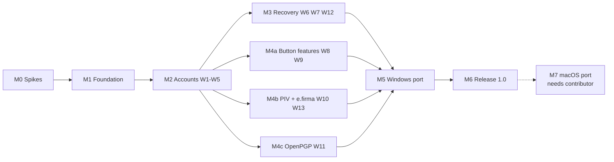

# Roadmap overview

Source: `IDEA.md` (accepted 2026-11-09). Scope, principles and workflow numbers (W1–W13) refer to that document.

**Platform order:** Linux first, then Windows. M0–M4 build and verify on Linux only (x86-64, plus ARM64 cross-built and run in an emulated VM); M5 ports the feature-complete app to Windows; M6 ships **1.0 on Linux and Windows**. macOS (M7) is outside 1.0 and happens only if an external contributor with Mac hardware takes it on ([decision](../decisions/2026-11-09-release-platforms-and-test-hardware.md)). On Linux only Wayland sessions are supported; only the latest release of each OS is tested, plus Ubuntu LTS. All testing runs on VMs with the keys passed through over USB: see the [development environment](../runbooks/dev-environment.md).

## Milestones

| # | Milestone | Workflows | Outcome |
|---|---|---|---|
| M0 | [Spikes](phase-0-spikes.md) | — | Every technical risk that matters on Linux answered; home screen and two-key idea checked with real people (U0); decisions recorded |
| M1 | [Foundation](phase-1-foundation.md) | — | App builds for Linux x86-64 and aarch64, detects a real YubiKey, speaks es/en; lane contracts and design tokens frozen; W1–W5 wireframes reviewed |
| M2 | [Accounts on two keys](phase-2-accounts.md) | W1–W5 | A new user protects email on both keys; codes, secrets file, recovery sheet; first usability round passed |
| M3 | [Recovery and reset](phase-3-recovery.md) | W6, W7, W12 | Lost key, blocked PIN and reset are safe; product core (W1–W7) complete |
| M4 | [Beyond accounts](phase-4-beyond-accounts.md) | W8–W11, W13 | Button features, PIV + e.firma, OpenPGP; three sub-tracks in parallel |
| M5 | [Windows port](phase-5-windows.md) | W1–W13 | Every workflow works on Windows x86-64 and ARM64, admin prompt only where FIDO needs it |
| M6 | [Release 1.0](phase-6-release.md) | — | Linux + Windows, tested key models passed, translations reviewed, packaging decided |
| M7 | [macOS port](phase-7-macos.md) | W1–W13 | After 1.0; needs an external contributor |

M3 and M4 run side by side: both need M2's secrets file and checklist, neither needs the other. M3's reset check must cover the PIV and OpenPGP unlock options once M4 adds them; that hand-off is listed in both phase files.

## Lanes

Lanes are parallel work streams that cut across milestones. Each lane owns its crate or folder and talks to the others only through the contracts below.

| Lane | Owns | Main inputs |
|---|---|---|
| **KEY** | `crates/key`: `yubikit` adapter, device discovery, every applet operation, transport quirks (`pcscd` and device permissions on Linux, `scdaemon`, Windows elevation from M5) | `yubikit` (pinned) |
| **VAULT** | `crates/vault`: age secrets file, unlock identities, in-memory key generation, OpenPGP/X.509 certificates, PIN rules, admin code generation, e.firma parsing, memory wiping | KEY contract |
| **CORE** | `crates/core`: key registry, checklist, status, workflow state machines, reset safety check, non-secret app state on disk | KEY, VAULT, SHEET contracts |
| **UI** | `crates/app`: Slint shell, screens, components, advanced details view | CORE view models, CONTENT strings, DESIGN wireframes and tokens |
| **DESIGN** | `docs/wireframes/`, `docs/brand/`: information architecture, wireframes for every workflow state, design tokens and component inventory, step illustrations, app icon, accessibility target, usability rounds | `IDEA.md` principles and workflows, CONTENT copy |
| **CONTENT** | `content/`: plain-language copy, es/en translations, curated site list with illustrated steps, guides for third-party apps | site list schema, string conventions |
| **SHEET** | `crates/sheet` + `templates/recovery-sheet/`: data mapping, QR SVG generation, Typst rendering to PDF | sheet data schema |
| **PLATFORM** | CI, build targets (Linux first, Windows from M5), VM lab ([dev environment](../runbooks/dev-environment.md)), OS integration (screen capture, data folders, elevation), packaging | — |

**DESIGN runs one milestone ahead of UI.** A workflow's wireframes are reviewed before its screens are built: W1–W5 during M1, W6/W7/W12 and W8–W11/W13 during M2. Wireframes cover every state, not only the happy path: waiting for a key, "touch your key", busy, error, empty, and interrupted (key pulled mid-write, app closed mid-flow). They live in `docs/wireframes/<workflow>.es.md` and `.en.md`; Spanish is drawn first because it runs longer. A screen that departs from its wireframe changes the wireframe first.

## Contracts (frozen in M1)

Freezing these lets every lane work against fakes while the others land.

| Contract | Between | Shape |
|---|---|---|
| `KeyPort` trait | KEY → CORE, VAULT | Discovery and hotplug events, device info, one sub-trait per applet; typed errors (not a YubiKey, busy in another program, key service not running, no permission for the device, wrong PIN with tries left). M5 adds "needs admin". In-memory fake for tests. |
| `SecretsStore` API | VAULT → CORE | Create, unlock with an identity, add/remove entries, list/add/remove unlock methods, re-encrypt. Plaintext only in zeroizing buffers. |
| Sheet data schema | CORE → SHEET | `templates/recovery-sheet/example.json` is the reference; QR codes arrive as SVG strings (`qr_svg`). |
| Site list schema | CONTENT → CORE, UI | Per site and language: name, category, settings URL, supported methods (passkey, security key, codes), 3–5 steps with images, backup-code flag. |
| View models | CORE → UI | Slint globals/structs per workflow screen; no applet terms outside the advanced details view. |
| String conventions | CONTENT ↔ UI | Every string through `@tr` / gettext with a context per screen; `.po` files for es and en. |
| Design tokens and components | DESIGN → UI | Token values (type scale, colour, spacing, warning levels) in one table that the Slint globals mirror; a component inventory (key status strip, step card, PIN field, code row, "plug in" / "touch your key" prompts, warning by level, shown-once code screen, confirmation) with its states and accessible names. |

## Decisions to record

Each one becomes `docs/decisions/YYYY-MM-DD-<topic>.md` when made.

| ID | Question | Decided in | Blocks |
|---|---|---|---|
| D1 | Can the `age` crate take custom identities, or do we drive the existing plugins over the plugin protocol? | M0 | VAULT in M2 |
| D2 | Which unlock option(s) ship in M2, and which one the app recommends (`IDEA.md`: still open) | M0, on Linux facts; re-checked in M5 | VAULT, CONTENT in M2 |
| D3 | OpenPGP library: `sequoia-openpgp` or `pgp` (rPGP) | M0 | M4c |
| D4 | X.509 library: `rcgen` or `x509-cert` | M0 | M4b |
| D5 | Recovery sheet rendering: embed the `typst` crate or ship the Typst CLI | M0 | SHEET in M1 |
| D6 | Windows: does CTAP2 over CCID on USB avoid the admin prompt? Firmware 5.8 supports FIDO over CCID; check 5.8 keys and whether older firmware does it too | M5 | Windows passkey screens, D2 re-check |
| D7 | `yubikit` go/no-go and the trigger for the `ctap-hid-fido2` + `pcsc` fallback | M0, revisited each milestone | KEY |
| D8 | When the PIV and OpenPGP PINs are changed from factory: at W1, or when PIV/OpenPGP is first set up | M1 | CORE in M2 |
| D9 | Packaging and signing for Linux and Windows (`IDEA.md` → Later) | M6 | Release |
| D10 | Linux computer sign-in for W10: which PAM/smart card stack the guide uses with the PIV certificate | M4b | W10 on Linux |
| D11 | What W10 offers on Windows, where local-account smart card sign-in may need extra software (to verify) | M5 | W10 on Windows |
| D12 | Build baseline: which tested release (latest of each distro, plus Ubuntu LTS) has the oldest glibc and system libraries; re-checked when a guest moves to a new release | M1 | Guest test builds, D9 |
| D13 | Visual direction: custom components on Slint's base, or one of Slint's built-in styles; light and dark themes | M1 | UI in M1 |
| D14 | Accessibility target: keyboard-only use of every workflow, screen reader coverage (Orca on Linux, Narrator from M5), contrast and text scaling levels | M0 spike, decided M1 | UI in M1, M6 audit |
| D15 | Step illustrations: site screenshots, drawn illustrations, or text only; who updates them when a site changes | M1 | CONTENT in M2 |
| D16 | W2 window layout: the steps must stay readable while the user works in the browser (compact side-by-side mode, or full window) | M1, after U0 | UI in M2 |
| D17 | Key identity: how the user tells main and spare apart, on screen and in hand (names, colours, a sticker on the sheet) | M1 | W1 wireframes |

D8 is new: W1 says "one PIN", but the PUK and OpenPGP admin PIN must be stored in the secrets file, which doesn't exist at W1. Setting only the user PINs at W1 leaves factory admin codes until first use; waiting leaves factory user PINs.

D10 and D11 follow from the platform order: `IDEA.md` used to put macOS account pairing first in W10; with macOS outside 1.0, W10 ships with a Linux guide and whatever D11 decides for Windows.

**Risk from moving D6 to M5:** if D2 picks FIDO2 as the recommended unlock option and Windows turns out to need the admin prompt for every unlock, the recommendation may have to differ on Windows. Files already made stay openable; only the default for new setups changes.

D13–D17 are design decisions with the same weight as the technical ones: each changes what the UI lane builds, and changing them after M2 means rebuilding screens.

## Hardware test matrix

Only two models can be tested: **YubiKey 5** (two of them) and **Security Key**. Everything else is a known gap: the app still reads each key's capabilities and offers only what it supports, but those paths are never run on hardware, and the 1.0 release notes list them as untested.

| Key | Status | Covers |
|---|---|---|
| 2× YubiKey 5, latest firmware (bought for the project) | Tested | Every applet; main and spare; PUK byte rule from 5.7 |
| Security Key | Tested | FIDO-only spare: passkey pair flows with a YubiKey 5, and every "spare without codes / PIV / OpenPGP / OTP" path |
| YubiKey 5, firmware 5.2.3–5.6 | Gap | Pre-5.7 PUK behaviour; OpenPGP Curve25519 floor at 5.2.3; 25-passkey and 32-code limits and the 20-passkey warning (`IDEA.md` → Key storage limits), covered only through the fake `KeyPort`. Both test keys are on current firmware, so this stays untested on hardware |
| YubiKey 4 | Gap | U2F only (no passkeys, no FIDO2 unlock), no Curve25519 OpenPGP, e.firma import unchecked |

Pair flows that write codes, OpenPGP, PIV or challenge-response to both keys run on the **two YubiKey 5**. They are release gates from M2 on (W1, W2 with codes, W4, W6), not a hardware gap: the fake `KeyPort` doesn't count as passing them.

## Usability rounds

Each round uses about five people who match `IDEA.md` → Who it's for (never project members or security-minded friends), with both languages represented. Every issue that stops a participant is fixed and re-checked before the gate closes; smaller issues go to the next milestone's wireframes.

| Round | When | What participants do | Gates |
|---|---|---|---|
| U0 | M0 | Paper or clickable prototype: home screen, W1, W2. Checks that "What do you want to protect?" and the two-key idea make sense before anything is built | M1 wireframes |
| U1 | M2 exit | Built app on real keys: fresh pair → protect email → get a code | M2 |
| U2 | M3 exit | Read the W6, W7 and W12 warnings and say in their own words what will be lost | M3 |
| U3 | M4 exit | W9, W10, W11 on their own apps; W13 with people who hold an e.firma | M4 |
| U4 | M6 | Release build, W1–W7, on Linux and Windows | 1.0 |
